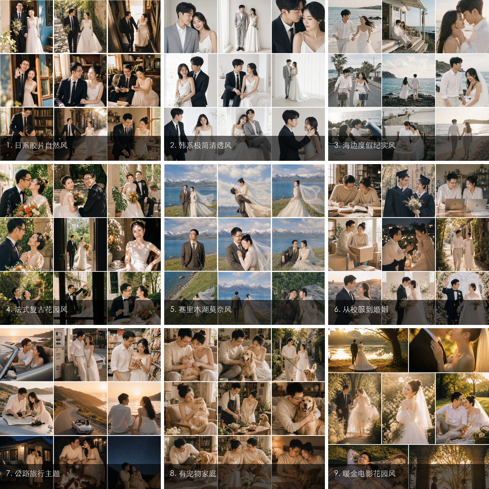

# AI Wedding Photo Skill

一套面向 Codex 和其他支持 Agent Skill 规范的 AI 婚纱照工作流。

它会主动展示 9 种婚纱照风格及九宫格参考图，引导用户选择风格与生图模型，然后输出适配该模型的提示词、分镜清单和负面提示词。在 Codex 中，如果当前环境提供生图工具，还可以继续使用上传的情侣或宠物参考照直接生成图片。

## 9 种风格



1. 日系胶片自然风
2. 韩系极简清透风
3. 海边度假纪实风
4. 法式复古花园风
5. 赛里木湖莫奈风
6. 从校服到婚姻
7. 公路旅行主题
8. 有宠物家庭
9. 暖金电影花园风

## 安装

将 `ai-wedding-photo` 文件夹复制到 Codex Skills 目录：

```bash
cp -R ai-wedding-photo ~/.codex/skills/
```

然后在对话中使用：

```text
使用 $ai-wedding-photo 帮我做一套 AI 婚纱照
```

## 工作流程

1. 展示九种风格和参考九宫格。
2. 让用户选择风格，或根据场景、氛围和故事偏好推荐。
3. 询问使用 OpenAI/ChatGPT Images、Midjourney、Nano Banana、即梦、豆包或其他模型。
4. 收集情侣及宠物参考照、画幅和必要偏好。
5. 输出导演式分镜表，为每张照片分别设计景别、互动、动作、表情和构图。
6. 为 6-9 个分镜分别生成独立提示词，逐张生图，避免整套姿势雷同。
7. 在具备生图工具的 Codex 环境中继续生成与迭代。

## 项目结构

```text
ai-wedding-photo/
├── SKILL.md
├── agents/openai.yaml
├── assets/style-previews/
├── references/styles.md
├── references/shot-direction.md
├── references/model-adapters.md
└── scripts/make_contact_sheet.py
```

## 许可

代码和文字采用 MIT License。示例图片的肖像权、著作权与训练/生成平台条款需由发布者单独确认；仓库开源许可不自动授予第三方使用示例人物肖像的权利。
